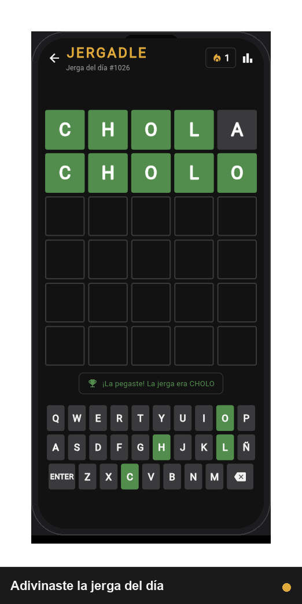
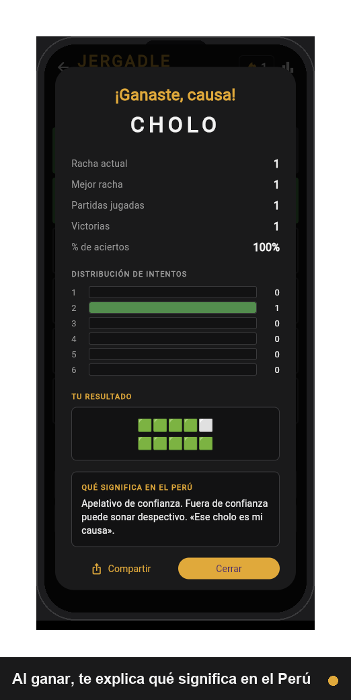
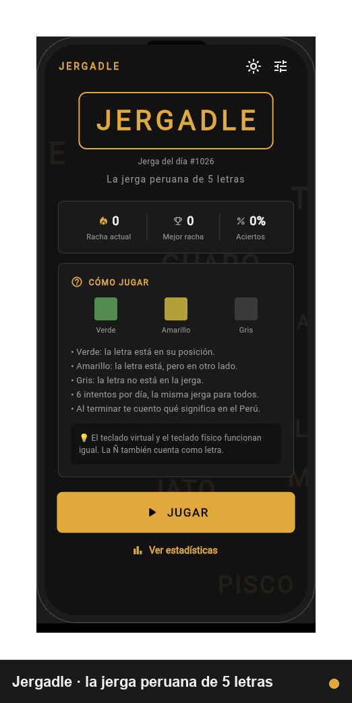

# Jergadle

<p align="center">
  
</p>

<p align="center">
  <b>Wordle peruano.</b> Adivina la jerga del día en 5 letras, todos los días,<br>
  desde tu celular o tu navegador.
</p>

<p align="center">
  <a href="https://jergadle.vercel.app/" target="_blank">▶️ Jugar en el navegador</a>
  ·
  <a href="#cómo-ejecutar">📱 Instalar en Android</a>
</p>

<p align="center">
  
  
  
</p>

---

- 🇵🇪 84 jergas limeñas de 5 letras en el diccionario local
- 🎯 6 intentos por día, misma palabra para todos (sin backend)
- 🔥 Rachas diarias y mejor racha guardadas en el dispositivo
- 📖 Al terminar te mostramos **qué significa la jerga en el Perú**
- 📱 Android + 🌐 Web (responsive)
- 🌗 Tema claro y oscuro, con sonido y animaciones

---

## Cómo jugar

| Color | Significado |
|-------|-------------|
| 🟩 Verde | La letra está en la posición correcta |
| 🟨 Amarillo | La letra existe, pero en otra posición |
| ⬜ Gris | La letra no está en la palabra |

Escribe con el teclado virtual (incluye la **Ñ**) o con tu teclado físico.
En la pantalla de inicio ya puedes escribir: la primera letra te mete
directo al juego.

Al terminar la partida se abre un modal con tus estadísticas, la distribución
de intentos y el **significado peruano de la jerga del día**. Desde ahí puedes
copiar tu resultado con el cuadro de emojis estilo Wordle:

```
Jergadle 3/5
🟩⬜🟨⬜🟩
🟩🟩🟩🟩🟩
```

### Ajustes

En la pantalla de inicio, el icono de **rayos** (arriba a la derecha) alterna
entre tema claro y oscuro, y el de **ajustes** abre el panel con sonido,
feedback háptico y consejos. Todo se guarda en el dispositivo.

---

## Cómo ejecutar

Requisitos: Flutter 3.47+ (Dart 3.13+).

```bash
# Instalar dependencias
flutter pub get

# Ejecutar en web (Chrome)
flutter run -d chrome

# Ejecutar en un dispositivo Android
flutter run -d <device-id>

# Tests
flutter test

# Análisis estático
flutter analyze

# Build de producción
flutter build web --release      # salida en build/web
flutter build apk --release      # salida en build/app/outputs/flutter-apk
```

---

## Arquitectura

```
lib/
├── main.dart                     # punto de entrada
├── app.dart                      # MaterialApp + MultiProvider
├── core/theme/app_theme.dart     # temas claro/oscuro + colores semánticos
├── models/
│   ├── word_entry.dart            # jerga + significado peruano
│   ├── game_guess.dart            # intento evaluado + LetterResult
│   ├── game_stats.dart            # rachas, victorias, distribución
│   ├── daily_game.dart            # estado serializable de la partida
│   └── app_settings.dart          # tema, sonido, háptica
├── data/peruvian_words.dart      # diccionario local (84 jergas)
├── services/
│   ├── storage_service.dart       # SharedPreferences (async)
│   ├── word_service.dart          # palabra del día (epoch + módulo)
│   ├── letter_evaluator.dart      # algoritmo de dos pasadas
│   └── sound_service.dart         # efectos de sonido (audioplayers)
├── providers/
│   ├── game_provider.dart         # ChangeNotifier con toda la lógica
│   └── settings_provider.dart     # preferencias del jugador
├── ui/
│   ├── screens/
│   │   ├── home_screen.dart       # pantalla de inicio con las reglas
│   │   └── game_screen.dart       # layout responsive del juego
│   └── widgets/
│       ├── letter_tile.dart        # ficha con giro 3D
│       ├── grid_board.dart         # tablero 6x5 en cascada
│       ├── virtual_keyboard.dart   # teclado QWERTY con Ñ
│       ├── stats_dialog.dart       # modal + cuadro de emojis
│       ├── shake_transition.dart   # sacudida del tablero
│       ├── home_background.dart    # jergas flotantes
│       ├── settings_sheet.dart     # hoja de ajustes
│       └── app_header.dart         # cabecera con racha
└── utils/day_key.dart             # helpers de fecha (yyyy-MM-dd)
assets/audio/                      # efectos de sonido (.wav)
```

### Palabras repetidas

El evaluador usa dos pasadas (igual que Wordle):

1. **Verdes primero**: toda letra en su posición exacta se marca verde y se
   "consume" de la palabra secreta.
2. **Amarillos después**: para el resto, se cuenta cuántas letras quedan
   disponibles. Si no queda ninguna, la letra es gris.

Esto evita el error clásico de marcar en amarillo una letra que en realidad no
está en la palabra.

### Palabra del día

```dart
index = diasTranscurridosDesde(2024-01-01) % totalDePalabras
```

Como el diccionario es local y está en el mismo orden para todos, todos los
usuarios obtienen la misma palabra el mismo día, sin necesidad de servidor.

### Rachas

- `currentStreak`: +1 al ganar; si se salta un día, se reinicia a 0.
- `maxStreak`: récord histórico.
- Si se juega dos veces el mismo día, la racha no se altera.
- Las estadísticas sólo se cuentan cuando la partida **termina**, no en cada
  intento.

### Persistencia

Todo se guarda en `SharedPreferences` con claves versionadas:

| Clave | Contenido |
|-------|-----------|
| `jergadle.stats` | estadísticas y rachas (JSON) |
| `jergadle.daily.<yyyy-MM-dd>` | partida del día (intentos + estado) |
| `jergadle.daily.last` | clave del último día jugado |
| `jergadle.history` | historial de partidas |
| `jergadle.settings` | tema, sonido, háptica y consejos |

Al reabrir la app el mismo día, la partida se restaura tal cual estaba.

---

## Flujo de trabajo (GitFlow)

El repositorio sigue [GitFlow](https://gitflow.gitbook.io/):

```
main        # producción: solo releases con tag SemVer
develop     # integración: siempre desplegable
feature/*   # una rama por funcionalidad, PR hacia develop
release/*   # preparación de release, PR hacia main
hotfix/*    # correcciones urgentes desde main
```

Reglas:

- Cada `feature/*` sale de `develop` y vuelve a `develop` vía **Pull Request**.
- Commits con [Conventional Commits](https://www.conventionalcommits.org/):
  `feat(ui): ...`, `fix(provider): ...`, `docs: ...`, `test: ...`, `chore: ...`.
- Merges con `--no-ff` para conservar el historial de la rama.
- `main` sólo se modifica mediante un PR de `release/*` o `hotfix/*`.
- Todo PR debe pasar `flutter analyze` y `flutter test`.

Detalle completo en [CONTRIBUTING.md](CONTRIBUTING.md).

---

## Extender el diccionario

Las 84 jergas son **de uso real en Lima y la costa central**, tomadas de:

- **DiPerú**, diccionario de la Academia Peruana de la Lengua
- **Peruanismos de Lima y la costa central** (108 términos)
- **Wikilengua**, *Jerga juvenil/Perú*
- **Martha Hildebrandt**, *Peruanismos*

Quedaron fuera las palabras que no son propiamente peruanas (chileno,
argentino, mexicano) y las que son español estándar sin uso jergático local.

Todas tienen **exactamente 5 letras** y se pueden teclear con el teclado
virtual (el test lo comprueba letra por letra). Algunas son de registro vulgar
(`CACHI`, `TARRO`, `PICHI`, `TALCO`), tal como se usan en la calle.

Para añadir más, inserta en `lib/data/peruvian_words.dart` (en orden
alfabético):

```dart
WordEntry(
  word: 'NUEVA',
  definition: 'Significado peruano de la jerga.',
);
```

El test `word_service_test.dart` valida que todas tengan 5 letras, que no
haya duplicados, que las definiciones no contengan caracteres corruptos y que
cada letra exista en el teclado.

---

## Identidad visual

El logotipo es el propio tablero del juego: un cuadro 2×2 con los tres
colores de evaluación y la "J" en el color de acento.

| Archivo | Uso |
|---------|-----|
| `web/favicon.png` | Pestaña del navegador (32×32) |
| `web/icons/Icon-192.png`, `Icon-512.png` | PWA e `apple-touch-icon` de iOS |
| `web/icons/Icon-maskable-*.png` | Iconos adaptativos de Android (zona segura) |
| `android/.../mipmap-*/ic_launcher.png` | Lanzador de Android (5 densidades) |
| `web/og-image.png` | Vista previa al compartir el enlace (1200×630) |
| `docs/logo.png` | Cabecera del README |
| `docs/screenshots/*.png` | Capturas de la app con marco de dispositivo |

Todos se generan con un solo script, para que sean reproducibles:

```bash
python scripts/generate_icons.py
```

Requiere `Pillow` (`pip install pillow`). La "J" sólo se dibuja cuando la
celda mide 44 px o más, de modo que el favicon de 32 px se queda en un
tablero de cuatro bloques limpio.

> El favicon lleva `?v=2` en el `index.html` porque los navegadores cachean
> los iconos de forma agresiva: sin el versionado, buena parte de los
> usuarios seguiría viendo el icono anterior.

### Capturas de pantalla

Las imágenes de `docs/screenshots/` se toman automáticamente del navegador
(con un Chrome headless), se les pone un marco de teléfono o de navegador y se
componen en un carrusel:

```bash
flutter build web --release
python scripts/make_screenshots.py
```

El carrusel `docs/screenshots/carrusel.png` (1200×1200) está pensado para
acompañar la publicación en redes sociales.

---

## Despliegue web (Vercel)

La app web es un sitio estático: Vercel sólo sirve los archivos de
`build/web`. El despliegue está automatizado con **GitHub Actions** para no
gastar minutos de build de Vercel y aprovechar la caché del SDK de Flutter.

### 1. Crear el proyecto en Vercel

Hay dos rutas. **No es obligatorio importar el repositorio.**

#### Ruta A — Crear el proyecto con la CLI (recomendada)

```bash
npm install --global vercel@latest
vercel login
vercel link --yes --project=jergadle    # crea el proyecto si no existe
```

`vercel link` genera `.vercel/project.json` con **los dos IDs que
necesitas**:

```json
{ "orgId": "team_xxxxxxx", "projectId": "prj_xxxxxxx" }
```

Ventajas: sin builds rojos en el dashboard de Vercel, sin doble despliegue, y
Vercel nunca ve tu código (sólo recibe el `.vercel/output` compilado).

#### Ruta B — Importar el repositorio desde el dashboard

1. Entra en [vercel.com/new](https://vercel.com/new) e importa
   `BryanPool99/jergadle`.
2. **Framework Preset:** `Other`.
3. **Build Command:** `flutter build web --release --no-web-resources-cdn`
4. **Output Directory:** `build/web`
5. Despliega una vez.

> Vercel no tiene Flutter en su imagen de build, así que **su propio build
> va a fallar**. Es inofensivo: el deploy real lo hace GitHub Actions. Para
> evitar que Vercel intente construir, `vercel.json` ya incluye
> `"git": { "deploymentEnabled": false }`, que desactiva la integración
> nativa de Git y con ello el doble despliegue.

En ambas rutas la URL será `jergadle.vercel.app` (si el nombre está libre; si
no, `jergadle-xxx.vercel.app`, cámbiala en *Settings → Domains*).

### 2. Los tres secretos

| Secreto | Dónde se saca |
|---------|---------------|
| `VERCEL_TOKEN` | [vercel.com/account/tokens](https://vercel.com/account/tokens) → *Create Token* (Full Access). También `vercel tokens add` |
| `VERCEL_ORG_ID` | Proyecto → *Settings → General* → **Organization ID**. En cuenta personal es tu *User ID* (Account Settings → General) y empieza por `team_` |
| `VERCEL_PROJECT_ID` | Proyecto → *Settings → General* → **Project ID** |

Atajos: `vercel link` local te los deja en `.vercel/project.json`, y
`vercel project ls` los muestra en la terminal.

Créalos en GitHub en *Settings → Secrets and variables → Actions*.

### 3. Qué hace el workflow

`.github/workflows/deploy-web.yml` tiene tres trabajos:

| Job | Cuándo corre | Qué hace |
|-----|--------------|----------|
| `test` | siempre | `flutter analyze` + `flutter test`. **Ninguna versión se despliega si falla.** |
| `deploy-production` | push a `main` | Compila y despliega a producción (`jergadle.vercel.app`) |
| `deploy-preview` | push a `develop` o PR | Compila y despliega una URL de preview |

Cada despliegue usa el flujo oficial de Vercel:

```
vercel pull              ->  descarga .vercel/project.json
vercel build             ->  ejecuta el buildCommand y deja .vercel/output
vercel deploy --prebuilt --prod
```

### 4. Despliegue manual

```bash
npm install --global vercel@latest
vercel login
export VERCEL_TOKEN=<tu token>
bash scripts/deploy-web.sh --prod
```

El script lee el token de la variable `VERCEL_TOKEN` (nunca del código) y
hace `vercel link` la primera vez, si el proyecto aún no está vinculado.

### Detalles importantes de la configuración

`vercel.json` define lo que hace que la app funcione bien:

- **`--no-web-resources-cdn`**: sin este flag, Flutter descarga el motor
  CanvasKit desde `gstatic.com`. Con él, el motor se sirve desde el mismo
  dominio: más rápido y sin depender de Google (muy útil en redes de Perú).
- **`Cache-Control`**: `main.dart.js` tiene nombre fijo, así que **no puede**
  cachearse un año o los usuarios se quedarían con la versión vieja para
  siempre. Va con `max-age=0, must-revalidate`. En cambio `assets/` y
  `canvaskit/` sí se cachean un año (`immutable`), porque no cambian.
- **`Content-Type: application/wasm`**: necesario para que el navegador
  compile el motor con WebAssembly.
- **`rewrites`**: todo cae en `index.html`. Vercel sirve primero los archivos
  del disco, así que los assets no se rompen.
- **`"git": { "deploymentEnabled": false }`**: desactiva la integración nativa
  de Git de Vercel. Sin esto, un mismo push dispararía **dos** despliegues
  (el de Vercel y el de GitHub Actions) y el de Vercel fallaría, porque no
  tiene Flutter en su imagen de build.
- **`VERCEL_TOKEN` por variable de entorno**: si el token se pasa con
  `--token=...` queda visible en el listado de procesos del runner. El
  workflow lo exporta como variable de entorno en el job.
- **`--non-interactive`**: en CI plano la CLI de Vercel no lo añade por
  defecto (sólo lo hace si detecta que corre dentro de un agente), y sin él
  puede quedarse esperando una confirmación.

### Service worker y PWA

El service worker de Flutter **se mantiene activo**: la app se puede instalar
como PWA y el juego funciona sin conexión (útil para la jerga del día).
Flutter versiona el `flutter_service_worker.js` y, gracias a los headers
anteriores, una actualización se descarga en la visita siguiente. Si prefieres
que la app nunca se cachee, quita el `flutter_service_worker.js` del build (la
app sigue funcionando, solo pierde el modo offline).

---

## Licencia

MIT
